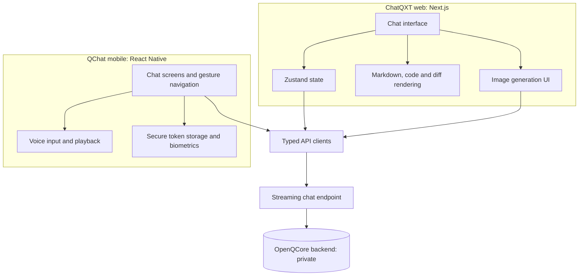

# ChatQXT and QChat

**The conversational product built on OpenQCore: a streaming chat experience on the web and on mobile.**

[Back to the platform overview](../README.md)

ChatQXT is the conversational product of the OpenQCore platform. **ChatQXT** is its technical name and **QChat** is the public name used for the mobile and consumer app. Both clients talk to the same backend, so a conversation, a model choice, and a wallet behave the same everywhere. The source code is private, and a live walkthrough is available on request.

> **Status:** final pre-launch development.

## At a glance

| | Web (ChatQXT) | Mobile (QChat) |
|---|---|---|
| Framework | Next.js 16, React 19 | React Native, Expo |
| Language | TypeScript, ~27K lines | TypeScript, ~12K lines |
| State and data | Zustand, TanStack Query | TanStack Query, secure storage |
| Languages | 9 | 9, with Arabic fonts and right-to-left layouts |
| Targets | Browser | Android and iOS (device testing so far on Android) |

## What it does

- **Streaming conversation.** Responses stream as they are generated, and the interface shows four phases to the user: thinking, searching, reviewing, and writing.
- **Model choice.** Users pick among the models the platform routes to, with provider fallback handled by the backend.
- **Rich messages.** Markdown with code highlighting and a diff view for code changes.
- **Long conversations.** Virtualized message lists keep scrolling smooth as history grows.
- **Image generation.** An interface for generating and viewing images through the platform's visual engine.
- **Sign-in.** Email and password, Google, and Microsoft, with multi-factor authentication support.
- **Mobile extras.** Voice input and playback, biometric unlock, push notifications, and location-based weather on the welcome screen.

## Architecture

*Conceptual diagram, not a deployment specification.*

## Design decisions

**One backend contract for both clients.** Web and mobile use the same streaming endpoint and the same status phases, so a feature added in the backend appears in both without a second implementation.

**Virtualized message list.** Only the messages near the viewport are rendered, which keeps long conversations responsive.

**Session expiry handled centrally.** An expired session produces one clear notice instead of scattered failures across the interface.

**Animation on the UI thread (mobile).** Navigation gestures run through Reanimated worklets, which keeps motion smooth even when the JavaScript thread is busy.

**One scaling system (mobile).** A single sizing module scales layout across phones and tablets and across Android and iOS.

**Translations as data.** Each language is one JSON file, with English as the fallback for any missing key, so adding a language is a data task rather than a code change.

**Right-to-left from the start.** Arabic layouts and fonts are part of the design on both clients, not a later patch.

## Technology

| Concern | Web | Mobile |
|---|---|---|
| Framework | Next.js, React | React Native, Expo, Expo Router |
| State | Zustand | React context, secure storage |
| Data fetching | TanStack Query, Axios | TanStack Query |
| Rendering | react-markdown, highlight.js, diff, react-virtuoso | react-native-markdown-display, highlight.js |
| Animation | Framer Motion, Lottie | Reanimated, Gesture Handler |
| Audio | not applicable | expo-audio, expo-speech |
| Security | Token-based sessions | Secure store, biometric authentication |

## Roadmap

- Automated tests for the streaming client and the message renderer
- Continuous integration for lint, type check, and build
- iOS device testing and store submission

## Related

- [Platform overview and backend architecture](../README.md)
- [OpenQCore dashboard and website](openqcore-dashboard.md)
- [chatqxt.com](https://chatqxt.com)
