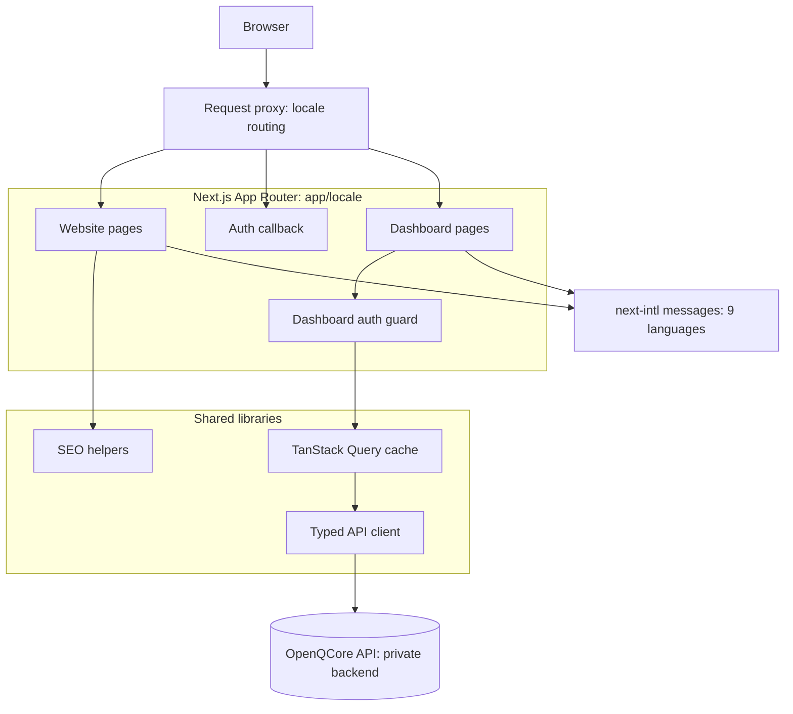

# OpenQCore Dashboard and Website

**The control dashboard and public website of OpenQCore: a multilingual, workspace-aware Next.js application.**

[Back to the platform overview](../README.md)

This document describes the OpenQCore web application: a public marketing site and an authenticated dashboard where teams manage agents, knowledge bases, API keys, members, usage, and billing. The source code is private, and a live walkthrough is available on request.

> **Status:** final pre-launch development.

## At a glance

| | |
|---|---|
| Size | ~78K lines of TypeScript across 405 TS/TSX files |
| Routes | 99 pages, split between the website and the dashboard |
| Languages | 9, with full right-to-left support for Arabic |
| Framework | Next.js 16 (App Router), React 19, TypeScript 5 |
| Styling | Tailwind CSS 4, Framer Motion |
| Data layer | TanStack Query with a typed API client (51 modules) |
| Internationalisation | next-intl, one JSON file per language, translation tooling |

## What it covers

**Dashboard** (authenticated):
- Workspaces and a workspace switcher, with personal and workspace scopes
- Agents with model selection and versioning
- Knowledge bases for retrieval
- API keys, members, and invitations
- Usage analytics, wallet balance, and usage tiers
- Upgrade and downgrade flows for personal and workspace plans
- Storage and compute resources
- Notifications, command palette, and a collapsible sidebar

**Website** (public):
- Platform pages: models, enterprise, analytics, studio, agents
- Solutions pages, including government solutions
- Changelog, SEO metadata, and industry imagery
- Every page available in all 9 languages

## Architecture



*Conceptual diagram, not a deployment specification.*

## Design decisions

**Locale-first routing.** Every route lives under one locale segment, so all 9 languages share one route tree. Arabic switches the layout to right-to-left, and components use logical CSS properties (`start` and `end` rather than `left` and `right`), so one component works in both directions.

**One session, one guard.** The dashboard sits behind a single auth guard. Session expiry is handled centrally in the API client, which shows a dedicated notice instead of letting individual screens fail one by one.

**Clear scope semantics.** Personal and workspace scopes look different throughout the dashboard (amber for personal, red for workspace), so users always know whose wallet and data an action affects.

**Explicit loading and empty states.** The workspace switcher distinguishes "still loading" from "no workspaces yet", and a zero-workspace account gets a create prompt instead of an empty screen.

**One startup call.** The dashboard loads session, workspaces, and billing state through the backend's bootstrap endpoint, so a page starts with one round trip instead of several.

**Server state in one place.** Backend data goes through TanStack Query, so caching, invalidation, and loading states are consistent across screens.

**Dark-only interface.** One carefully tuned theme rather than two half-tuned ones.

## Technology

| Concern | Choice |
|---|---|
| Framework | Next.js 16, React 19 |
| Language | TypeScript |
| Styling | Tailwind CSS 4, clsx, tailwind-merge |
| Data fetching | TanStack Query, Axios |
| Internationalisation | next-intl |
| Charts | Recharts |
| Animation | Framer Motion |
| UI primitives | Radix UI (Popover), cmdk, lucide-react |

## Project structure

```
app/
  [locale]/
    (marketing)/     public website pages
    (dashboard)/     authenticated dashboard
    auth/            sign-in callback
    changelog/
  lib/
    api/             typed API client modules
    seo/             metadata helpers
    constants/
    runtime/
i18n/                locale configuration
messages/            one JSON file per language
scripts/             translation tooling
public/images/       website imagery
```

## Roadmap

- Automated tests for the API client and the dashboard auth flow
- Continuous integration for lint, type check, and build

## Related

- [Platform overview and backend architecture](../README.md)
- [ChatQXT and QChat](chatqxt.md)
- [openqcore.com](https://openqcore.com)
