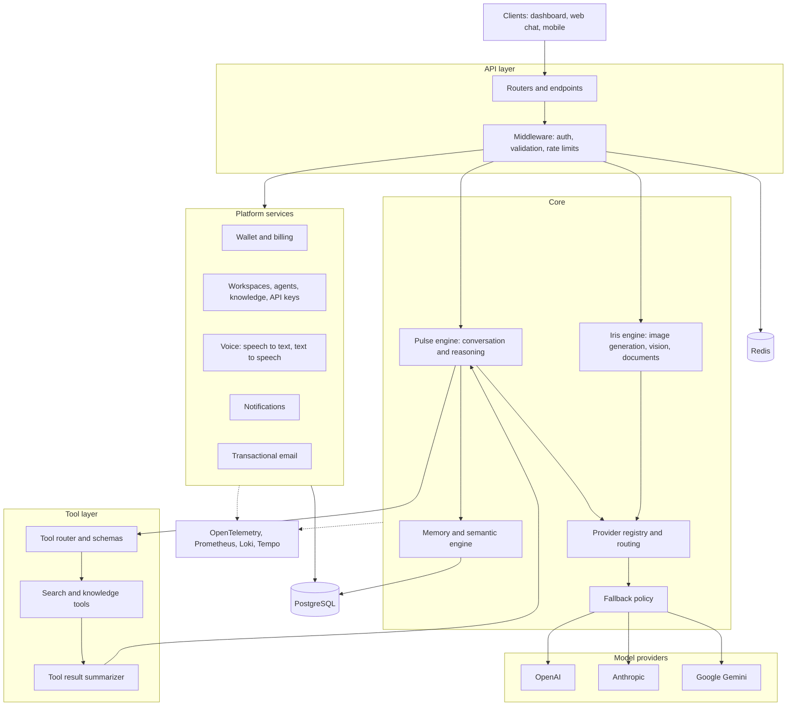

# OpenQCore: Backend Architecture Overview

**The backend of OpenQCore: a model-agnostic AI core, a tool layer, and the platform services around them.**

This repository is a public technical overview of the OpenQCore backend: how the core engines, providers, tools, memory, and platform services fit together. The backend source is private. A live code walkthrough is available on request.

> **Status:** final pre-launch development.

## At a glance

| | |
|---|---|
| Language and framework | Python, FastAPI, async I/O |
| Size | ~93K lines of Python in 510 modules |
| API surface | **279 REST endpoints** |
| Database | PostgreSQL, SQLAlchemy 2.0, 17 Alembic migrations |
| Cache and coordination | Redis |
| Model providers | OpenAI, Anthropic, Google Gemini behind one routing layer |
| Operations | Docker, Nginx, OpenTelemetry, Prometheus, Loki, Tempo, Alertmanager |

## Architecture

*Conceptual diagram, not a deployment specification.*

## Core

**Pulse engine.** The conversational engine. It resolves the requested model, decides whether tools are needed, streams the response in four phases (thinking, searching, reviewing, writing), and settles usage against the user's wallet. Fast rules handle trivial messages without a full model call, including Arabic-aware matching.

**Iris engine.** The visual engine: image generation, computer vision, OCR, and document analysis behind one interface, with provider abstraction for image and vision backends.

**Provider registry and routing.** Models are interchangeable resources. A model slug resolves to a primary provider and registered fallbacks. Providers (OpenAI, Anthropic, Google) implement one interface, including native tool calling.

**Fallback policy.** If a model's primary and fallback providers both fail, the same request is retried transparently against a lower-cost default model before an error reaches the user.

**Memory and semantic engine.** Embedding-based retrieval (sentence-transformers, scikit-learn) for per-user memory and workspace knowledge, with chunking and embedding pipelines for uploaded documents.

## Tool layer

Each tool declares an explicit parameter schema, so arguments are validated before a call. Tool results are summarized generically, whatever shape they return, before going back to the model.

Search and knowledge tools: web search, Wikipedia, Stack Exchange, arXiv, weather, GitHub, news, Wolfram, YouTube.

## Platform services

- **Billing and wallet:** per-user and per-workspace wallets, reserve-then-settle accounting, token-based pricing calibrated per provider, usage tiers, and graceful downgrade to a lower-cost model when credits run out.
- **Workspaces:** agents with model versioning, knowledge bases linked to agents, API keys (hashed), members and invitations, usage analytics, storage, and compute resource tables.
- **Voice:** speech to text with automatic language detection, text to speech through provider voices, audio conversion, and text cleaning for natural pronunciation.
- **Document intelligence:** OCR, PDF and Office parsing, document generation (PDF, Word, Excel, PowerPoint), QR and barcode generation and reading, Arabic text shaping.
- **Notifications:** persistent notifications with a service layer, REST endpoints, and a background cleanup worker.
- **Bootstrap endpoint:** one call returns the session, workspaces, and billing state a client needs at startup.
- **Auth and security:** JWT, OAuth2 (Google, Microsoft), TOTP multi-factor authentication, Argon2 password hashing.

## Autolearn

A separate package for domain "minds" (design, brand, research, engineering, business, language, and others) and a fine-tuning data pipeline: curated training samples with an approval gate, a dataset builder, a model registry, and fine-tuning job submission to external model APIs.

## Code organization

| Package | Role | Files |
|---|---|---|
| `app/core` | Engines, providers, memory, settings, shared utilities | 198 |
| `app/api` | Versioned API endpoints | 76 |
| `app/services` | Business logic: chat, billing, workspaces, voice | 65 |
| `app/models` | SQLAlchemy models | 25 |
| `app/tools` | Tool router and tool implementations | 18 |
| `app/routers` | Route registration | 17 |
| `app/schemas` | Pydantic schemas | 14 |
| `alembic` | Database migrations | 17 |

## Observability and operations

Distributed tracing, metrics, logs, and alerting run through OpenTelemetry, Prometheus, Loki, Tempo, and Alertmanager, with alert rules defined as code. The service ships as Docker containers behind Nginx.

## Engineering notes

- **Latency:** time-to-first-token cut from 7.9 s to 3.0 s (about 62%) by moving heavy pre-model work behind the first streamed status event, backgrounding message persistence, and moving the database closer to the API.
- **Billing correctness:** a pricing lookup failure for providers without a default pricing row was traced to a missing parameter in the settlement path and fixed at the call site.
- **Reliability:** empty-reply safety-net retry, provider fallback, and request-scoped tracing.

## Research

The architecture is informed by a control-theoretic view of AI systems.

- **Preprint:** *Artificial Intelligence Needs Control Theory: Towards Stable, Adaptive, and Autonomous AI Systems.* [Zenodo](https://doi.org/10.5281/zenodo.23378510). Results come from a simulated plant and are a consistency check of the framework, not evidence of production LLM performance.
- **In preparation:** *Empirical Evaluation of Delay-Induced Instability in Multi-Agent LLM Orchestration.*

## About this repository

It contains public architecture documentation and illustrative examples (see `docs/` and `examples/`). It does not contain the private backend source, credentials, database dumps, customer data, or internal configuration.

## Author

**Mohamed Eid**, architect and lead engineer. Independent researcher (ORCID 0009-0008-8404-978X).

- Website: [openqcore.com](https://openqcore.com)
- GitHub: [Mo-eid200](https://github.com/Mo-eid200)

---

&copy; 2026 OpenQCore. Documentation only; all rights reserved.
