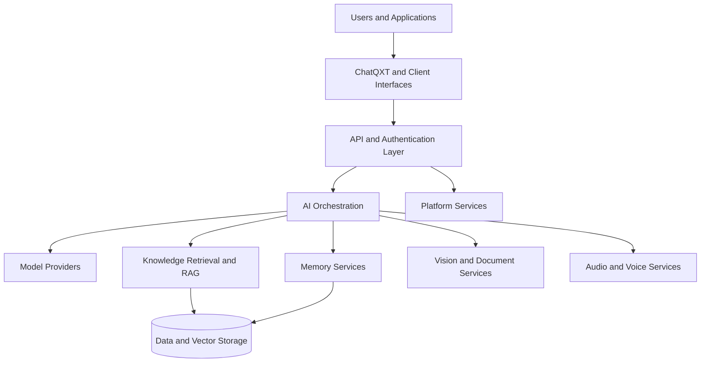

# OpenQCore — AI Platform Architecture

**Research. Engineering. Intelligence. Transformation.**

OpenQCore is a research-driven AI platform designed to bring together model integration, intelligent orchestration, conversational systems, knowledge retrieval, multimodal capabilities, and enterprise-oriented services within a modular architecture.

This repository presents a public overview of the platform's architecture and engineering approach. It is intended for technical reviewers, engineering teams, and organizations interested in AI systems architecture.

## Platform Overview

OpenQCore is the underlying AI platform. **ChatQXT** is its conversational product, built on top of the platform's capabilities.

The architecture is organized around several key domains:

- **AI Orchestration** — Integrating model providers and coordinating requests across platform services.
- **Conversational Intelligence** — Supporting context-aware interaction and conversation workflows.
- **Knowledge Retrieval (RAG)** — Combining semantic and keyword-based retrieval to ground responses in relevant information.
- **Memory Services** — Organizing contextual information, retrieval, ranking, and summarization.
- **Vision and Document Intelligence** — A modular approach to image analysis, OCR, and document processing.
- **Voice Services** — Integrating speech input and audio generation through provider-based services.
- **Platform Services** — Supporting authentication, workspaces, usage tracking, billing, and API access.

Feature availability and maturity may vary by module.

## High-Level Architecture

*This is a conceptual architecture diagram, not a complete deployment specification.*

## Engineering Approach

The platform uses a modular backend architecture with technologies and patterns including:

- Python and FastAPI for API services
- PostgreSQL and vector search for structured data and retrieval workflows
- Redis for supporting application services
- Docker for containerized deployment
- Provider abstractions for integrating external AI models and services

Specific implementation details may evolve as the platform develops.

## Research

OpenQCore's research explores the engineering principles needed to make AI systems more stable, adaptive, and controllable.

**Research paper:** *Artificial Intelligence Needs Control Theory: Towards Stable, Adaptive, and Autonomous AI Systems*

[Read the paper on Zenodo](https://doi.org/10.5281/zenodo.23378510)

The paper presents the proposed Unified Cognitive Control Framework (UCCF) and simulation-based evaluation. Its reported results should be interpreted in the context of those experiments, not as a claim of proven performance across production AI systems.

## About This Repository

This repository contains public-facing architecture documentation and illustrative material. It does not serve as the source distribution for OpenQCore's private backend.

Production credentials, private source code, database dumps, customer data, and internal configuration files do not belong here.

## Links

- **OpenQCore:** https://openqcore.com
- **ChatQXT:** https://chatqxt.com
- **GitHub:** https://github.com/Mo-eid200

---

Built as part of the ongoing engineering and research work behind OpenQCore.
