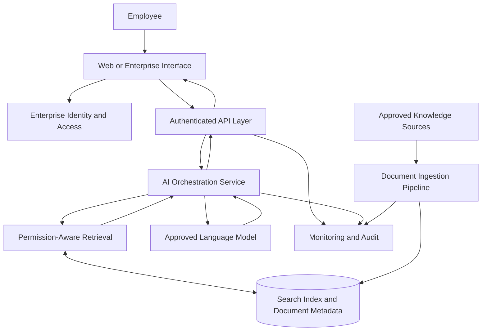

# Enterprise AI Knowledge Assistant
## Solution Architecture Case Study

**Document type:** Reference architecture and proposed solution design  
**Status:** Conceptual design — not a production deployment

## 1. Business Problem

An enterprise wants to help employees find trustworthy answers across internal policies, operating procedures, technical documentation, and approved knowledge sources.

Employees currently spend time searching multiple repositories and may receive inconsistent answers or rely on outdated documents.

The proposed solution is an AI knowledge assistant that retrieves relevant internal information, generates evidence-grounded answers, and provides references to the supporting sources.

## 2. Business and Technical Requirements

- Retrieve information from approved enterprise knowledge sources.
- Preserve existing document access permissions.
- Provide source references for generated answers.
- Integrate with enterprise identity and access management.
- Support monitoring, auditability, and operational troubleshooting.
- Control model usage, latency, and cost.
- Allow model and retrieval components to evolve independently.

## 3. Proposed Architecture

This diagram represents a conceptual design. Specific infrastructure and service choices should be confirmed during discovery.

## 4. Request Lifecycle

1. Authenticate the user and establish their identity and access context.
2. Validate the request and apply applicable input and usage controls.
3. Search approved knowledge sources using semantic and keyword retrieval.
4. Enforce document-level permissions before including content in the model context.
5. Rank and select relevant passages.
6. Generate an answer grounded in the selected evidence.
7. Return the response with source references where available.
8. Record operational metrics and audit events without unnecessarily storing sensitive prompt content.

The retrieval and generation stages should fail safely when required access checks or supporting services are unavailable.

## 5. Architecture Decisions

### Build, buy, or combine?

**Copilot Studio and existing Microsoft capabilities** may be suitable when the use case primarily involves Microsoft 365 workflows, standard connectors, and relatively straightforward orchestration.

**A custom application** may be appropriate when requirements demand specialised retrieval, custom APIs, greater control over model routing, or application-specific policies.

**A hybrid approach** may combine an enterprise-facing Microsoft interface with a governed custom API for specialised retrieval and business logic.

The final choice should follow requirements discovery, a proof of concept, and an assessment of licensing, integration effort, security, and operational ownership.

### Retrieval strategy

Hybrid retrieval combines semantic similarity with keyword matching. It can help balance conceptual relevance with exact matches for identifiers, product codes, and technical terminology.

Ranking methods should be evaluated against representative enterprise questions rather than assumed to be effective without testing.

### Provider abstraction

An orchestration layer can isolate application logic from individual model-provider APIs. Provider selection should consider quality, latency, cost, availability, privacy requirements, and supported capabilities.

Abstraction should not hide material differences in model behaviour, safety controls, or request formats.

## 6. Security and Governance

- Integrate with enterprise identity and access management.
- Enforce user permissions during retrieval, not only at the user interface.
- Treat retrieved documents as untrusted input; content must not override system instructions or access policies.
- Keep credentials in a managed secrets store.
- Apply encryption in transit and at rest where supported.
- Define logging, retention, residency, and deletion requirements.
- Use rate limits, request validation, and appropriate network boundaries.
- Test prompt injection, cross-user data exposure, and unauthorised document retrieval.
- Define human escalation for high-impact or low-confidence use cases.

Security and compliance requirements should be validated with the organisation's security and data-governance teams.

## 7. Reliability and Cost Management

The solution should monitor:

- End-to-end latency and retrieval latency
- Model-provider errors, timeouts, and rate limits
- Token consumption and estimated cost per request
- Retrieval relevance and source coverage
- Unsupported or insufficiently grounded answers
- Access-control failures and unexpected data exposure
- Service availability and ingestion freshness

Potential controls include bounded retries, timeouts, provider circuit breakers, caching where appropriate, model-routing policies, and usage quotas.

Retries should be limited and designed to avoid multiplying costs or duplicating side effects.

## 8. Evaluation Plan

Evaluation should use a representative, reviewed dataset of enterprise questions and expected evidence.

Measure:

- Retrieval relevance and recall
- Answer correctness and groundedness
- Source attribution quality
- Access-control correctness
- Latency and failure rates
- Cost per successfully answered request
- User feedback and escalation frequency

Establish a baseline before optimisation. Set acceptance thresholds with business and technical stakeholders, and report measured results separately from proposed targets.

## 9. Delivery Approach

**Phase 1 — Discovery:** Confirm users, data sources, access rules, compliance constraints, and success criteria.

**Phase 2 — Proof of concept:** Implement a limited ingestion and retrieval workflow using approved, non-sensitive sample content.

**Phase 3 — Evaluation:** Test retrieval quality, answer grounding, security boundaries, and cost assumptions.

**Phase 4 — Pilot:** Integrate identity, monitoring, feedback collection, and operational controls.

**Phase 5 — Production readiness:** Validate resilience, performance, governance, incident response, and ongoing ownership.

## 10. Key Risks

| Risk | Mitigation |
|---|---|
| Incorrect or unsupported answers | Evidence-based evaluation, source references, and safe escalation |
| Exposure of unauthorised documents | Identity-aware retrieval and access-control testing |
| Prompt injection in retrieved content | Treat retrieved text as untrusted data and enforce policy outside model instructions |
| Uncontrolled model spend | Usage budgets, quotas, monitoring, and routing policies |
| Provider outages | Timeouts, bounded retries, fallback policies, and graceful degradation |
| Stale knowledge | Ingestion monitoring, freshness checks, and defined update schedules |

## Scope and Limitations

This is a proposed reference architecture, not evidence of a deployed enterprise solution or tested production performance. Technology selections, service-level objectives, compliance requirements, and cost estimates must be validated against the actual environment.

The design intentionally excludes private source code, credentials, customer data, and internal production configuration.
