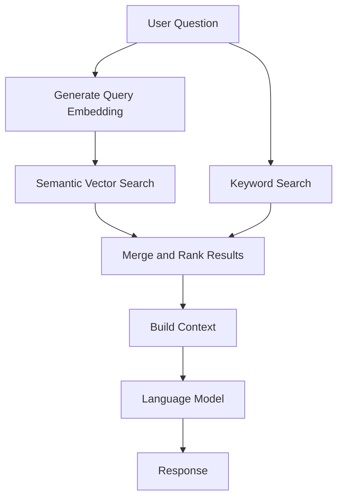

# Retrieval-Augmented Generation (RAG)

## Overview

Retrieval-Augmented Generation (RAG) connects language models with relevant information retrieved from a knowledge source. Instead of relying exclusively on a model's pre-trained knowledge, a RAG workflow retrieves supporting content at query time and uses it to construct a context-grounded response.

OpenQCore includes a retrieval workflow designed around semantic and keyword-based search.

## Workflow

## Main Stages

1. **Query processing:** Receive the user's question and prepare it for retrieval.
2. **Semantic retrieval:** Use vector embeddings to find content with related meaning.
3. **Keyword retrieval:** Search for relevant terms using text-based matching.
4. **Result combination:** Combine retrieval results and prioritize relevant content.
5. **Context construction:** Assemble selected passages into context for the language model.
6. **Response generation:** Generate an answer using the retrieved context.

## Why Hybrid Retrieval?

Semantic search can identify related concepts even when wording differs. Keyword search can help find exact terms, identifiers, and technical phrases. Combining both approaches can provide complementary retrieval signals.

Retrieval quality still depends on the source documents, chunking strategy, ranking logic, and evaluation methodology.

## Engineering Considerations

A robust RAG system should address:

- Document ingestion, normalization, and chunking
- Embedding generation and vector storage
- Retrieval ranking and duplicate handling
- Context limits and answer grounding
- Access control, rate limiting, and failure handling
- Evaluation using representative questions and reference answers

## Scope

This document describes the conceptual retrieval workflow. It is an architecture overview, not a claim that every listed capability has been independently benchmarked or deployed at production scale.

The document intentionally excludes private source code, credentials, customer information, and production configuration.
