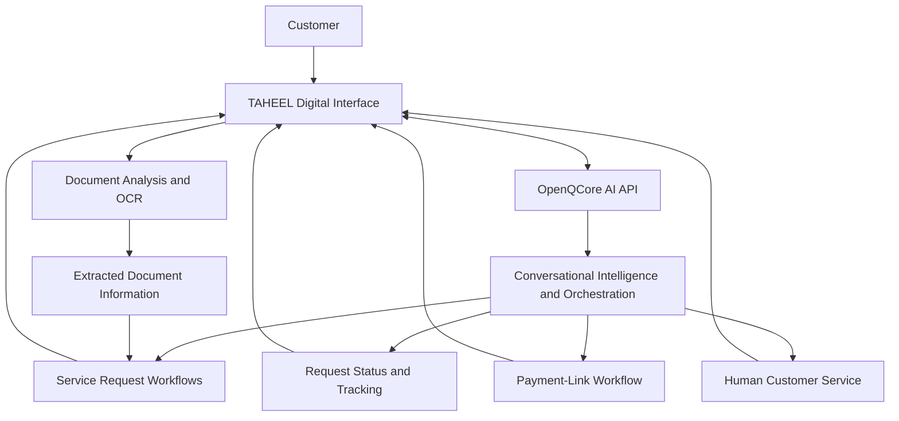

# OpenQCore × TAHEEL
## AI-Powered Customer Service and Document Intelligence

**Integration overview:** OpenQCore AI platform integrated with TAHEEL's digital government-services workflow.

**Document type:** Public-facing technical integration overview  
**Scope:** Functional capabilities and conceptual architecture

## 1. Overview

TAHEEL uses OpenQCore APIs to support AI-powered customer interactions and document-processing workflows.

The integration extends beyond a conventional chatbot. It connects conversational assistance with service-request workflows, request tracking, payment-link generation, status updates, and escalation to human customer service.

OpenQCore also supports AI-powered document analysis and information extraction, including OCR-related workflows.

Together, these capabilities demonstrate how an AI platform can support practical digital-service operations rather than limiting the experience to question answering.

## 2. Business Capabilities

### Conversational Customer Assistance

The AI assistant helps customers interact with TAHEEL's digital services through a conversational interface.

Depending on the service workflow, customers can:

- Ask questions and receive contextual assistance.
- Initiate service requests through the conversational experience.
- Track existing requests and check their status.
- Obtain payment links when applicable to a request.
- Receive assistance with the next steps in a service workflow.
- Escalate an interaction to human customer service when human intervention is needed.

The conversational interface serves as an access point to service workflows, rather than operating solely as a question-and-answer tool.

### Document Intelligence

OpenQCore supports document-analysis workflows that use AI and OCR-related capabilities to help process submitted documents and extract relevant information.

Potential workflow stages include:

1. Receive a document through an authorised application workflow.
2. Process its contents using suitable document-analysis or OCR capabilities.
3. Extract relevant information from the document.
4. Make the results available to the surrounding service workflow for appropriate follow-up.

Extraction results should be validated where needed, especially when errors could affect a government-service request or a customer's information.

## 3. Conceptual Integration Architecture

*This diagram is a conceptual representation of the functional integration, not a verified deployment topology or a complete inventory of implementation components.*

## 4. Conversational Service Lifecycle

A representative interaction may follow this sequence:

1. A customer starts a conversation with the TAHEEL assistant.
2. The assistant identifies the customer's request and determines the appropriate next step.
3. When the workflow requires an operational action, the relevant service capability is invoked through the surrounding integration.
4. The customer can receive request information, tracking updates, or a payment link when applicable.
5. If the interaction requires human assistance, it can be escalated to customer service.
6. The customer continues through the relevant service workflow.

The exact operations, permissions, and state transitions depend on the specific TAHEEL service and its implementation.

## 5. Engineering Considerations

Integrating conversational AI with operational workflows requires more than generating fluent text.

### Reliable Actions

Creating requests, generating payment links, and updating service workflows should be governed by application-side validation and authorisation. An AI-generated statement must not be treated as proof that an operation succeeded.

### State and Tracking

Request status should be derived from the authoritative service workflow, rather than inferred from conversation history alone.

### Human Handover

Escalation should preserve the relevant conversation context where permitted, while ensuring that the receiving customer-service team has the information and permissions required to continue the interaction.

### Document Processing

Document extraction should distinguish between extracted values and verified facts. Validation and exception handling are important when documents are incomplete, unclear, or inconsistent.

### Security and Privacy

A production integration should apply appropriate authentication, access controls, data minimisation, secure handling of document contents, and safeguards against unauthorised actions.

Sensitive credentials, customer documents, payment data, internal endpoints, and production configuration are intentionally excluded from this public overview.

## 6. Architectural Significance

This integration illustrates several important AI solution architecture patterns:

- Conversational AI connected to real business workflows.
- Separation between AI interpretation and authoritative service operations.
- API-based integration between an AI platform and a digital-services application.
- Document intelligence alongside conversational capabilities.
- Human escalation for cases requiring additional assistance.
- Workflow-aware handling of requests, payments, and status information.

These patterns are relevant to enterprise AI, intelligent customer service, workflow automation, and digital transformation initiatives.

## 7. Scope and Evidence

This document describes the functional integration context and a conceptual architecture based on the capabilities identified for TAHEEL.

It does not disclose private source code, API credentials, internal endpoints, customer information, or detailed production configuration. It also does not claim specific accuracy, response-time, cost-saving, or customer-satisfaction metrics, because no such measurements are presented here.

## Summary

The OpenQCore–TAHEEL integration illustrates an applied AI use case in which conversational assistance and document intelligence support a broader digital-service journey.

The central architectural principle is that AI should help users navigate and interact with operational workflows while authoritative application services remain responsible for validating and executing business actions.
